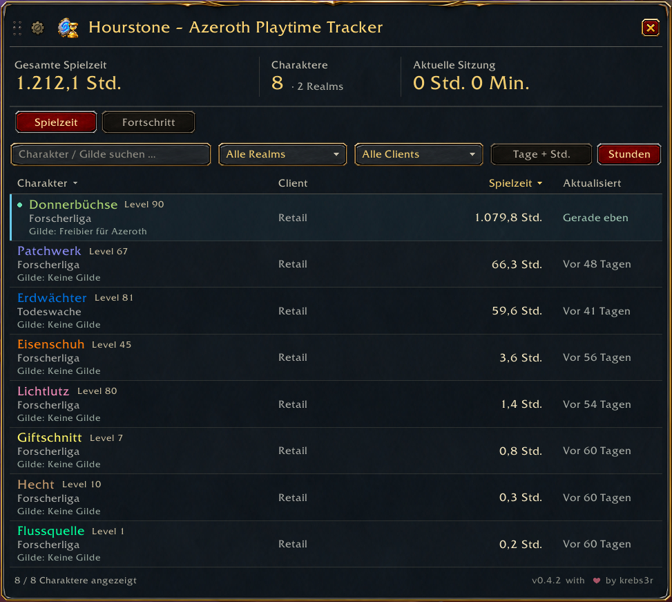
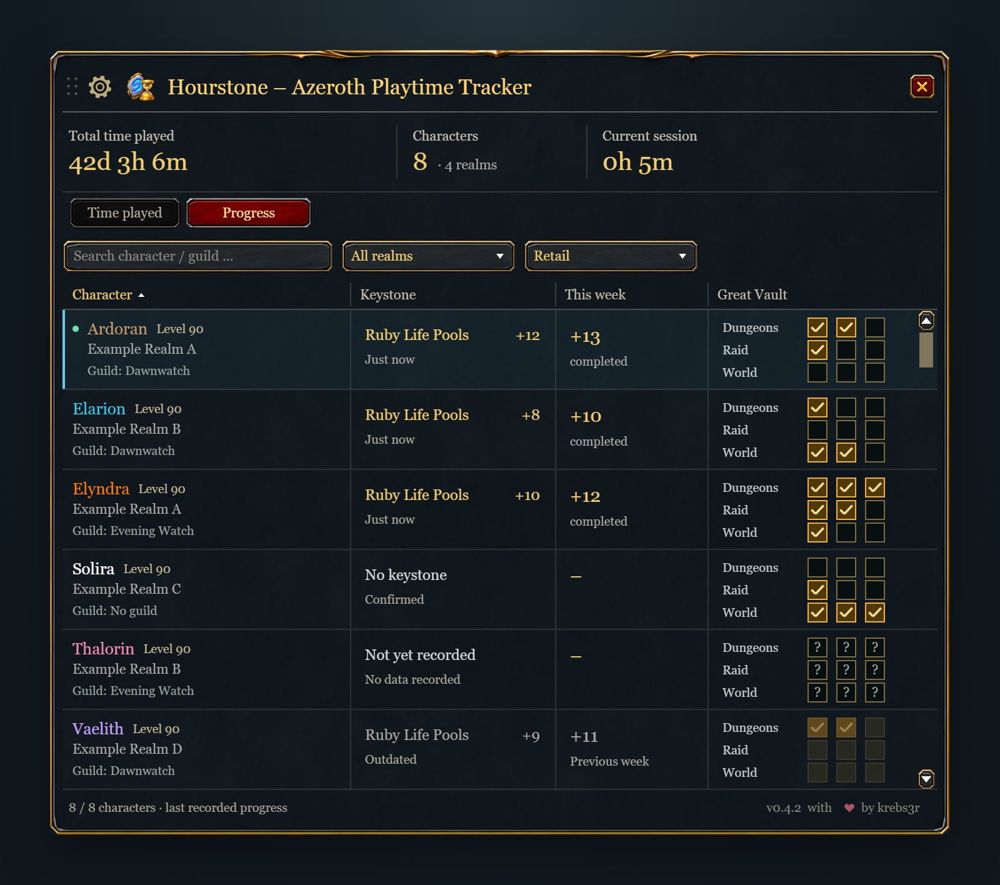
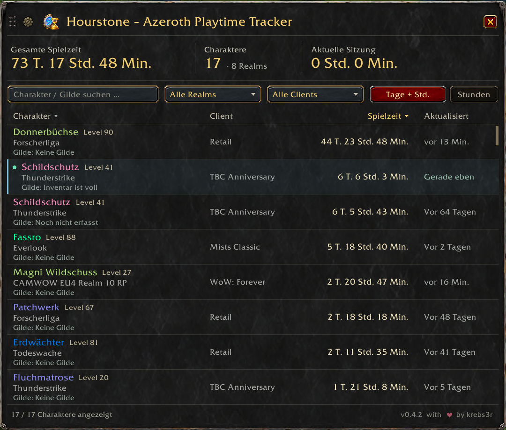
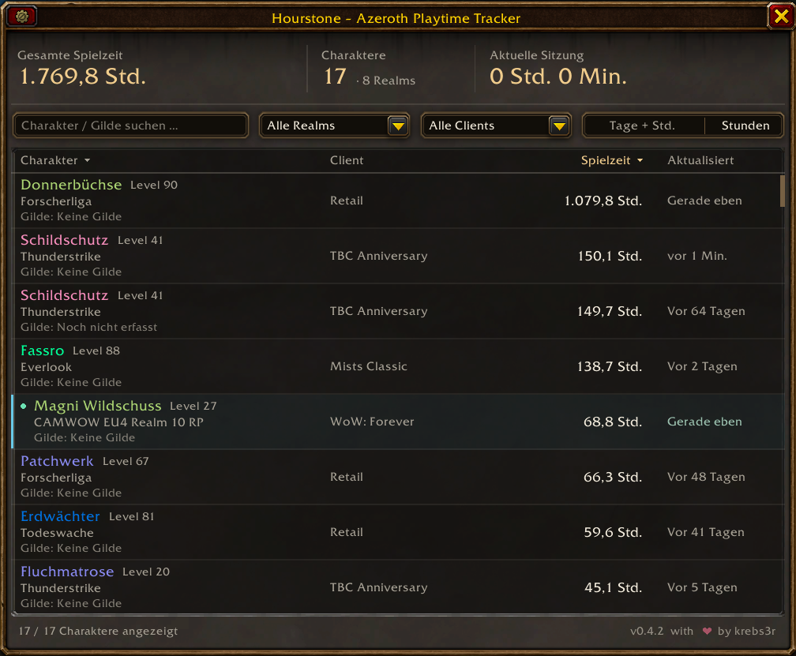

# Hourstone – Azeroth Playtime Tracker

**Your characters. Your time.**

Hourstone keeps the `/played` time of every character you log in with and shows them all in one window: your total playtime, the current session, and each character with class, level, realm and guild. On Retail, the **Progress** tab adds every character's keystone, weekly Mythic+ best and Great Vault slots. No other addon, app or account needed.

In-game screenshot from Retail with the author's own characters, German client.

## What it does

- **Every character's `/played`.** A character appears after its first login with Hourstone, with the server's full total, including the time you played before installing it. At the top: your total time played and the current session.
- **Find any alt.** Search by character or guild, filter by realm and client, and sort by any column. Hover a character for everything recorded about it.
- **Mythic+ and Great Vault on Retail.** For each character: the current keystone, the highest Mythic+ level completed this week, and all nine Vault slots for Dungeons, Raid and World, read straight from WoW. After the weekly reset, old values are marked outdated until you log that character in again.
- **Days or hours.** Show playtime as days, hours and minutes, or as decimal hours. The footer adds up the characters your filters show.
- **Keep the list tidy.** Right-click a character to remove it from the overview and its totals. Your WoW character and its saved playtime stay, and you can restore the entry at any time.
- **One download, five clients.** Retail, Mists of Pandaria Classic, TBC Anniversary, Classic Era and WoW: Forever.

The Progress tab, rendered from Hourstone's own layout with example characters.

## Options

Click the gear in the window, or type `/hourstone` (or `/azerothhours`) to open and close it:

- Hourstone's size, from 65 to 200 % in 5 % steps; drag the title bar to move the window;
- a minimap button to switch on or off; where the client has an Addons menu below the minimap clock, Hourstone opens from there too;
- the list of deleted characters, to restore them.

`/hourstone minimap` shows or hides the minimap button, `/hourstone reset` puts the window back in its place.

## Your client's look

Hourstone wears the look of the client it runs in: Retail's gold, Classic's iron and stone, and on WoW: Forever, Forever's own bronze window frame. In Forever, its characters show as **WoW: Forever** in the client column and filter.

In-game screenshots from TBC Anniversary and WoW: Forever with the author's own characters, German client. Characters from other clients appear with the optional Companion.

## Good to know

- **Log in once with each character.** Hourstone can only record characters you have played with it enabled. WoW saves the data when you log out or type `/reload`.
- **More than one PC or WoW version?** The optional [Hourstone Companion](https://github.com/krebs3r/hourstone-companion) for Windows brings the saved data of your installations, accounts and PCs into one overview, Mythic+ progress included. Setup and requirements are on its page; Hourstone works fully without it.
- English and German.

From the same author: [Buttonstone – Azeroth Minimap Buttons](https://www.curseforge.com/wow/addons/buttonstone-azeroth-minimap-buttons), [Soundstone – Azeroth Audio](https://www.curseforge.com/wow/addons/soundstone-azeroth-audio) and [Umbra Unit Frames](https://www.curseforge.com/wow/addons/umbra-unit-frames). Source, installation guide and issues: [GitHub](https://github.com/krebs3r/hourstone-azeroth-hours).

---

## Deutsch

**Deine Charaktere. Deine Spielzeit.**

Hourstone merkt sich die `/played`-Zeit jedes Charakters, mit dem du dich einloggst, und zeigt alle in einem Fenster: Gesamtspielzeit, aktuelle Sitzung und jeden Charakter mit Klasse, Level, Realm und Gilde. In Retail zeigt der Reiter **Fortschritt** dazu Schlüsselstein, beste M+-Stufe der Woche und Schatzkammer-Slots all deiner Twinks. Kein weiteres Addon, keine App, kein Konto nötig.

- **Die `/played`-Zeit jedes Charakters**, ab seinem ersten Login mit Hourstone, mit der vollen Spielzeit vom Server, auch der vor der Installation.
- **Jeden Twink finden:** Suche nach Charakter oder Gilde, Realm- und Clientfilter, sortierbare Spalten.
- **M+ und Schatzkammer in Retail:** aktueller Schlüsselstein, höchste abgeschlossene M+-Stufe der Woche und alle neun Slots für Dungeon, Raid und Welt, direkt aus WoW gelesen. Nach dem Wochenreset gelten alte Werte als veraltet, bis du den Charakter wieder einloggst.
- **Tage oder Stunden**, und unten die Summe der gefilterten Charaktere.
- **Aufräumen:** Per Rechtsklick verschwindet ein Charakter aus Übersicht und Summen. Dein WoW-Charakter und seine Spielzeit bleiben erhalten, und du kannst den Eintrag jederzeit wiederherstellen.
- **Ein Download, fünf Clients:** Retail, Mists of Pandaria Classic, TBC Anniversary, Classic Era und WoW: Forever, dort im bronzenen Fensterrahmen von Forever.

Einstellungen über das Zahnrad oder mit `/hourstone`: Größe von 65 bis 200 %, Minimap-Button und gelöschte Charaktere. Wo der Client ein Addons-Menü unter der Minimap-Uhr hat, öffnet Hourstone auch von dort. Mehrere PCs oder WoW-Versionen? Der optionale [Hourstone Companion](https://github.com/krebs3r/hourstone-companion) für Windows führt die gespeicherten Daten zusammen, M+-Fortschritt inklusive; Hourstone funktioniert auch ohne ihn.
